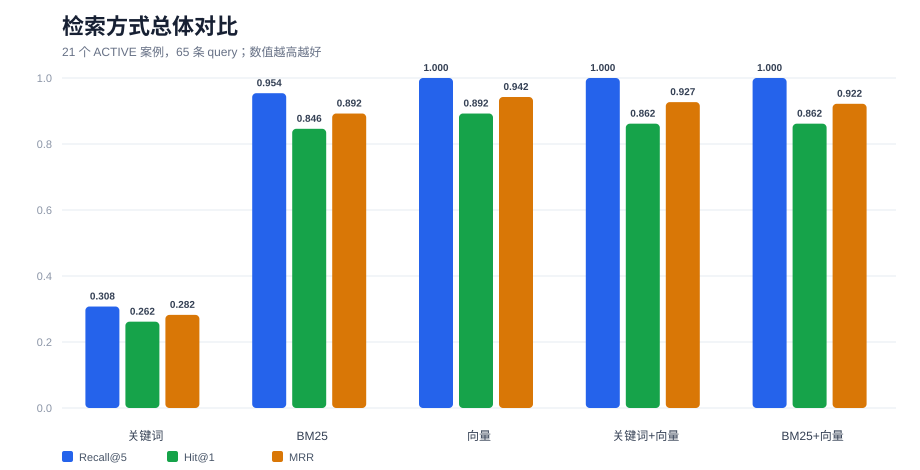
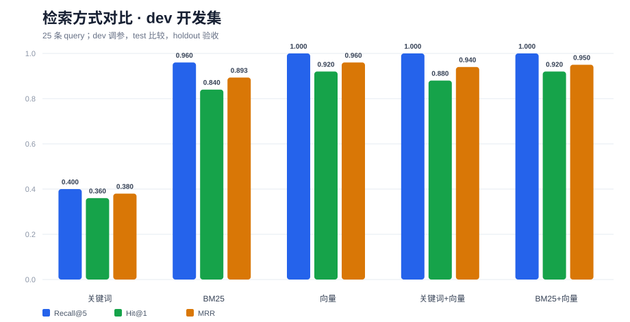
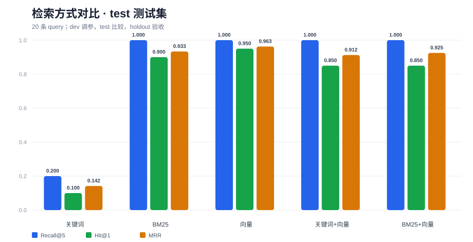
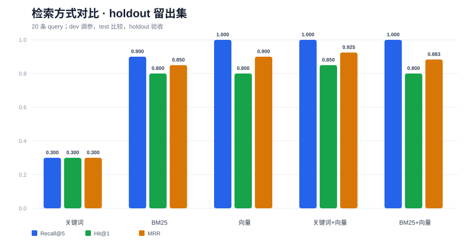
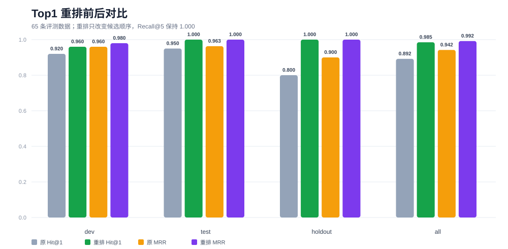
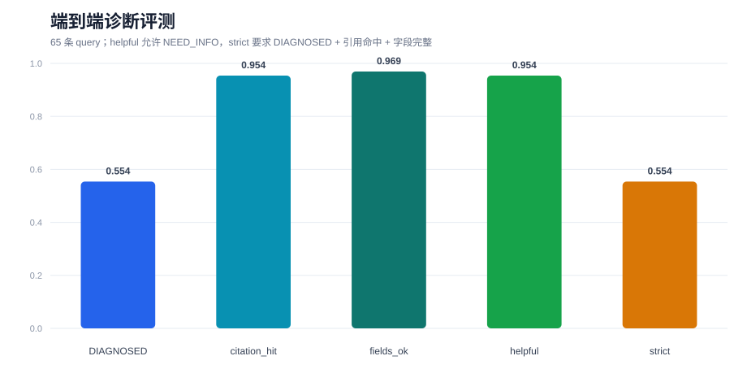

# TraceFix — Java 报错诊断与案例库

TraceFix 是一个面向 Java 开发者的报错诊断系统：粘贴真实报错后，系统解析堆栈、从结构化案例库中检索相似问题，生成带证据的诊断（原因、排查、修复、验证），并由人工确认修复是否有效。确认有效的案例回流到案例库，形成可复用的数据资产。

> 当前阶段：Java ↔ Python 诊断链路已打通；Python 已接入 DeepSeek 结构化生成、Qwen Embedding、FAISS 向量检索、Top1 重排和 LangGraph 编排；离线评测已建立 `dev/test/holdout` 三组数据。

## 解决什么问题

Java 报错排查通常有三个痛点：

1. 堆栈很长，新手不知道哪一行才是自己的代码。
2. 通用大模型的回答看起来合理，但缺少证据，无法确认是否适用于当前版本和框架。
3. 问题解决后经验留在聊天记录里，同类报错下次还要重新查。

TraceFix 把“报错—原因—修复—验证”整理成结构化案例，让诊断有证据、可确认、可复用。

## 核心流程

```text
提交报错
  → 解析异常类型 / 消息 / 指纹
  → 向量检索（主）；失败时 BM25，再失败时关键词
  → 候选案例
  → Top1 重排
  → LangGraph 编排
  → DeepSeek 生成结构化诊断：原因 / 修复 / 验证 / 引用
  → citations 白名单校验
  → 人工确认：原因对不对、修好没有
  → 修好：生成案例草稿；审核后进入正式案例库
```

## 功能状态

| 模块 | 状态 | 说明 |
|---|---|---|
| 文档录入 | 已实现 | `POST /doc/upload`，P1 原始资料 |
| 案例库 | 已实现 | 前端导入页、案例列表/详情、DRAFT → ACTIVE 审核、自动 fingerprint、caseNo 查重、工单回流 |
| 诊断记录 | 已实现 | 创建、列表、详情、人工确认 |
| Java → Python 通信 | 已实现 | `HttpAiClient` 调 FastAPI `/ai/diagnose` |
| 堆栈解析 | 已实现 | 异常类型、归一化消息、指纹 |
| Python 案例读取 | 已实现 | 从 MySQL 读取 `ACTIVE` 案例 |
| 关键词检索 | 已实现 | 异常类型匹配 + 消息关键词打分，作为最后兜底 |
| BM25 检索 | 已接入降级 | 中文单字 + 二元组切分；向量失败或为空时接替 |
| Top1 重排 | 已实现 | 向量 Top5 后用 DeepSeek 重排；失败回退原顺序 |
| 端到端诊断评测 | 已实现 | 跑完整 graph，统计 DIAGNOSED、引用命中、字段完整和延迟 |
| Embedding | 已实现 | 通义 `qwen3.7-text-embedding-flash`，1024 维 |
| FAISS 向量检索 | 已实现 | `IndexFlatIP` + L2 归一化，保存 `faiss.index` 和 `case_ids.json` |
| 诊断生成 | 已实现 | DeepSeek 输出结构化 JSON；包含字段完整性和引用校验 |
| LangGraph 编排 | 已实现 | retrieve → assess → generate → validate；检索降级为 vector → BM25 → keyword |
| 黄金评测集 | 已建立 | 65 条：`dev 25 / test 20 / holdout 20` |
| Mock AI | 已实现 | `ai.mock=true` 时使用，便于离线调试 |
| 前端页面 | 最小页面 | 诊断、案例导入、案例列表与审核 |
| RRF 混合检索 | 实验完成 | 离线对比无一致提升，暂不接入主流程 |

## 评测结果

当前 65 条评测数据覆盖 21 个 `ACTIVE` 案例，使用 `Recall@5`、`Hit@1` 和 `MRR` 作为检索指标。新增案例来源标注为“公开常见错误整理”，后续可补充真实 issue 链接。

> baseline：先跑通的简单方案，作为后续方案的对照。本项目把关键词检索作为 baseline，向量检索的效果要和它比较。

| split | cases | keyword Recall@5 | keyword Hit@1 | keyword MRR | vector Recall@5 | vector Hit@1 | vector MRR |
|---|---:|---:|---:|---:|---:|---:|---:|
| dev | 25 | 0.40 | 0.36 | 0.380 | 1.00 | 0.92 | 0.960 |
| test | 20 | 0.20 | 0.10 | 0.142 | 1.00 | 0.95 | 0.963 |
| holdout | 20 | 0.30 | 0.30 | 0.300 | 1.00 | 0.80 | 0.900 |

指标含义：

- `Recall@5`：正确案例是否出现在检索结果前 5 条中。
- `Hit@1`：正确案例是否排在第 1 条。
- `MRR`：正确案例排名的倒数平均值；第 1 名得 1，第 2 名得 1/2，第 3 名得 1/3，没进前 5 得 0。

评测解读：

- 关键词检索按空格分词，对中文自然语言和英文 `message_pattern` 的跨语言匹配能力弱，所以分数低。
- 向量检索通过 Embedding 把中文问题和英文案例映射到同一语义空间，因此对自然语言描述更稳定。
- 向量检索 `Recall@5=1.00`，但 `Hit@1` 不是 1.00，说明正确案例不总是排第一，排序质量仍有提升空间。
- 当前每组 20～25 条数据，指标只能说明当前样本上的效果，不能证明所有 Java 报错场景都有效。
- `dev` 用于调参，`test` 用于方案比较，`holdout` 最后验收；不要根据 `test` 或 `holdout` 的逐条结果反复调参。

### 评测图表

| 检索总体 | dev |
|---|---|
|  |  |
| **test** | **holdout** |
|  |  |

### BM25 对比

实现方式：英文按单词、中文按单字 + 二元组切分，使用 BM25（`k1=1.5, b=0.75`）打分。

| split | keyword Recall@5 | bm25 Recall@5 | bm25 Hit@1 | bm25 MRR | vector Recall@5 | vector Hit@1 | vector MRR |
|---|---:|---:|---:|---:|---:|---:|---:|
| dev | 0.40 | 0.96 | 0.84 | 0.893 | 1.00 | 0.92 | 0.960 |
| test | 0.20 | 1.00 | 0.90 | 0.933 | 1.00 | 0.95 | 0.963 |
| holdout | 0.30 | 0.90 | 0.80 | 0.850 | 1.00 | 0.80 | 0.900 |

结论：

- BM25 明显强于原来的关键词规则，说明中文切分和 IDF/长度归一化有效。
- BM25 仍然略低于向量检索：holdout Recall@5 为 0.90、MRR 为 0.850，而向量是 1.00 / 0.900。
- BM25 不替代向量主路径，但已接入向量失败/为空时的第一层降级；关键词保留为最后兜底。

### BM25 + 向量 RRF

实现方式：BM25 Top5 + 向量 Top5，使用通用 `rrf_merge` 融合。

| split | vector Hit@1 | vector MRR | bm25+vec Hit@1 | bm25+vec MRR |
|---|---:|---:|---:|---:|
| dev | 0.92 | 0.960 | 0.92 | 0.950 |
| test | 0.95 | 0.963 | 0.85 | 0.925 |
| holdout | 0.80 | 0.900 | 0.80 | 0.883 |

结论：

- 扩充并清理案例后，BM25 + 向量没有超过纯向量：dev 的 Hit@1 持平但 MRR 更低，test 和 holdout 也没有稳定提升。
- 说明之前的轻微优势主要来自旧样本，样本变化后不能复现。
- 当前不接入主流程；保留为可选检索策略，后续补数据后再验证。

### Top1 重排

实现方式：向量检索 Top5 后，把候选案例的 `case_no / title / message_pattern / root_cause` 交给 DeepSeek，让它只返回候选的新顺序。重排失败、返回非法 JSON 或 case_no 集合不一致时，保留原始顺序。

运行离线对比：

```bash
ai/.venv/Scripts/python.exe eval/rerank_eval.py --split dev
```

结果：

| split | vector Hit@1 | rerank Hit@1 | vector MRR | rerank MRR |
|---|---:|---:|---:|---:|
| dev | 0.920 | 0.960 | 0.960 | 0.980 |
| test | 0.950 | 1.000 | 0.963 | 1.000 |
| holdout | 0.800 | 1.000 | 0.900 | 1.000 |



结论：

- 65 条重排输出全部合法，Recall@5 保持 1.00。
- 整体 Hit@1 从 0.892 提升到 0.985，MRR 从 0.942 提升到 0.992。
- 三组都提升，但 dev 有 1 条从第 1 名降到第 2 名，属于个别回退，整体仍明显提升。
- 单次重排平均约 0.9 秒，会在生成前增加一次 DeepSeek 调用。
- 已接入 `generate`：先按检索阈值过滤候选，再重排；`assess_evidence` 仍用重排前的检索 top1 判断证据，避免低分候选被重排后误判。

### 端到端诊断评测

检索评测只检查 Top5/Top1，端到端评测会跑完整 LangGraph：

```text
query
→ 检索
→ 重排
→ assess
→ generate
→ validate
```

先跑 3 条 smoke：

```bash
ai/.venv/Scripts/python.exe eval/diagnosis_eval.py --split dev --limit 3
```

指标：

- `DIAGNOSED`：最终状态是否为 `DIAGNOSED`，这是严格口径。
- `citation_hit`：`matchedCaseIds` 是否包含 `expectedCaseNo`。
- `fields_complete`：`rootCause`、`fixSteps`、`verification` 是否都非空。
- `helpful`：引用命中且字段完整，允许状态是 `NEED_INFO`。
- `strict`：`DIAGNOSED` + 引用命中 + 字段完整。

`NEED_INFO` 不一定代表链路失败。如果模型给出了正确引用和完整诊断，只是要求补充版本或堆栈，`helpful` 仍算成功。

证据门槛 `EVIDENCE_THRESHOLD=0.55` 时，清理后的完整 65 条结果：

| split | cases | DIAGNOSED | citation_hit | fields_complete | helpful | strict | avg_ms | p95_ms |
|---|---:|---:|---:|---:|---:|---:|---:|---:|
| dev | 25 | 0.520 | 1.000 | 1.000 | 1.000 | 0.520 | 2615 | 3561 |
| test | 20 | 0.650 | 0.850 | 0.900 | 0.850 | 0.650 | 2234 | 4021 |
| holdout | 20 | 0.500 | 1.000 | 1.000 | 1.000 | 0.500 | 2364 | 3065 |
| all | 65 | 0.554 | 0.954 | 0.969 | 0.954 | 0.554 | 2420 | 3824 |



失败分析：

- 3/65 条 `helpful=False`：
  - test `ERR-SPRING-0001`：引用校验失败，有字段但没有有效引用。
  - test `ERR-SPRING-0003`、test `ERR-JAVA-0003`：仍在 `assess` 阶段被证据门槛拦截。
- `strict` 仍为 0.554，主要因为模型会主动返回 `NEED_INFO`，不完全代表链路失败。
- 逐条结果由评测脚本运行时输出，不提交生成文件。

### 评测命令

检索评测：

```bash
ai/.venv/Scripts/python.exe eval/run_eval.py --split dev
```

重排评测：

```bash
ai/.venv/Scripts/python.exe eval/rerank_eval.py --split dev
```

端到端诊断评测：

```bash
ai/.venv/Scripts/python.exe eval/diagnosis_eval.py --split dev --limit 3
```

评测图表保存在 `assets/eval/`，不依赖 Java 或 FastAPI 运行。

### RRF 混合检索实验

实现方式：关键词 Top5 + 向量 Top5，按 `case_no` 合并，使用 `1/(60+rank)` 计算 RRF 分数，再取 Top5。

| split | vector Hit@1 | vector MRR | hybrid Hit@1 | hybrid MRR |
|---|---:|---:|---:|---:|
| dev | 0.92 | 0.960 | 0.88 | 0.940 |
| test | 0.95 | 0.963 | 0.85 | 0.912 |
| holdout | 0.80 | 0.900 | 0.85 | 0.925 |

结论：

- dev 和 test 变差，holdout 变好，整体没有一致提升。
- 关键词检索本身噪声较大，RRF 会把它的错误排名带进融合结果。
- 关键词经常返回空，所以“关键词 + 向量 RRF”多数时候接近纯向量；BM25 每次都返回 Top5，等权融合时反而更容易把错误候选顶上来。
- 当前数据量小，暂不把 RRF 接入 `diagnosis_graph`；保留为离线实验和后续优化方向。

## 技术架构

```text
浏览器（HTML + JS）
   │ HTTP
Java 主服务（Spring Boot + MyBatis-Plus）
   │  ├─ 案例 / 诊断记录 / 人工确认（MySQL）
   │  └─ HttpAiClient ──────────────┐
   │                                │ HTTP
   │                                ▼
   │                    Python AI 服务（FastAPI）
   │                      ├─ 堆栈解析 / 指纹
   │                      ├─ MySQL ACTIVE 案例读取
   │                      ├─ VectorRetriever + FAISS（主）
   │                      ├─ BM25Retriever（第一层降级）
   │                      ├─ CaseRetriever（最后兜底）
   │                      ├─ Reranker（Top1 重排）
   │                      └─ LangGraph + DeepSeek
   │
MySQL（事实来源）
FAISS index（可重建的派生索引）
```

Java 负责业务状态和数据库写入，Python 负责解析、检索和模型调用。MySQL 是事实来源，FAISS 只作为可重建的派生索引。

## 技术栈

- Java 主服务：Spring Boot 4.1.2、MyBatis-Plus 3.5.18.1
- 数据：MySQL
- Python AI 服务：FastAPI、PyMySQL
- 编排：LangGraph
- 大模型：DeepSeek `deepseek-chat`
- Embedding：通义 `qwen3.7-text-embedding-flash`，1024 维
- 向量索引：FAISS `IndexFlatIP`（L2 归一化后等价余弦相似度）
- 前端：HTML + JS 多页面（诊断 / 导入 / 审核），同源部署
- 已做离线实验：RRF

## 数据模型

三张核心表：

| 表 | 作用 |
|---|---|
| `qa_document` | 原始资料/长文档，P1 使用 |
| `qa_error_case` | 结构化报错案例：异常类型、根因、修复步骤、验证方式、来源 |
| `qa_diagnosis_ticket` | 每次诊断的记录：输入、AI 诊断、置信度、人工确认、处理状态 |

案例库与诊断记录通过 `matched_case_ids` 和 `source_ticket_id` 逻辑关联，不建物理外键，避免高写入日志表被外键约束拖慢。

## API

| 方法 | 路径 | 状态 | 说明 |
|---|---|---|---|
| GET | `/api/health` | 已实现 | 健康检查 |
| POST | `/doc/upload` | 已实现 | 文档录入（P1） |
| POST | `/case/import` | 已实现 | 导入一条案例 |
| GET | `/case/list` | 已实现 | 查询案例列表 |
| GET | `/case/detail` | 已实现 | 案例详情 |
| POST | `/case/review` | 已实现 | 审核案例状态 |
| POST | `/case/promote` | 已实现 | 已解决工单生成案例草稿 |
| POST | `/diagnosis/analyze` | 已实现 | 提交报错并诊断；由 `ai.mock` 切换 Mock/Python |
| GET | `/diagnosis/ticket/list` | 已实现 | 查询诊断记录 |
| GET | `/diagnosis/ticket/detail` | 已实现 | 诊断记录详情 |
| POST | `/diagnosis/confirm` | 已实现 | 人工确认根因/修复效果 |

Python 服务额外提供：

| 方法 | 路径 | 说明 |
|---|---|---|
| GET | `/ai/health` | Python 服务健康检查 |
| POST | `/ai/diagnose` | 解析、向量检索、LangGraph 编排并返回结构化诊断 |

## 快速开始

### 1. 准备 MySQL

1. 创建 `tracefix` 数据库。
2. 执行 `server/sql/schema.sql`。
3. 准备少量 `qa_error_case` 数据，状态为 `ACTIVE` 才会参与检索。

### 2. 安装 Python 依赖

```bash
cd ai
python -m venv .venv
.venv\Scripts\python.exe -m pip install -r requirements.txt
```

### 3. 配置环境变量

创建 `ai/.env`（不要提交到 Git）：

```text
MYSQL_HOST=127.0.0.1
MYSQL_PORT=13306
MYSQL_USER=你的用户名
MYSQL_PASSWORD=你的密码
MYSQL_DATABASE=tracefix
```

Embedding 和 DeepSeek 的密钥放在本机环境变量或 `.env` 中：

```text
DASHSCOPE_API_KEY=你的通义密钥
DEEPSEEK_API_KEY=你的 DeepSeek 密钥
```

不要把真实密钥写进 README、代码或 Git。

### 4. 构建 FAISS 索引

在 `ai` 目录执行：

```bash
.venv\Scripts\python.exe scripts\build_faiss_index.py
```

会生成：

```text
ai/retrieval/index/faiss.index
ai/retrieval/index/case_ids.json
```

`case_ids.json` 的下标必须和 FAISS 内部 ID 一致；重建索引时要同时重建这两个文件。

### 5. 启动 Python 服务

```bash
.venv\Scripts\python.exe -m uvicorn main:app --reload --port 8000
```

### 6. 配置并启动 Java

复制：

```text
server/src/main/resources/application-example.yml
```

为：

```text
server/src/main/resources/application.yml
```

填入本地数据库配置，并确认：

```yaml
ai:
  base-url: http://127.0.0.1:8000
  mock: false
```

启动 `TraceFixApplication` 后访问：

```text
http://localhost:8080/
```

或检查：

```text
GET /api/health
GET http://127.0.0.1:8000/ai/health
```

开发环境数据库通过 SSH 隧道访问，真实密码不进入仓库。

### 7. 运行评测

在项目根目录执行：

```powershell
ai\.venv\Scripts\python.exe eval\run_eval.py --split dev
ai\.venv\Scripts\python.exe eval\run_eval.py --split test
ai\.venv\Scripts\python.exe eval\run_eval.py --split holdout
```

`holdout` 只用于最终验收，不要反复根据它调参。

## Mock AI 与真实 Python 的切换

```text
ai.mock=true  → MockAiClient
ai.mock=false → HttpAiClient → Python /ai/diagnose
```

`MockAiClient` 用于离线调试和跑通 Java 业务流程；`HttpAiClient` 用于真实检索链路。

当前 Python 的 `generate` 节点已经调用 DeepSeek，不再使用模板版。`validate_citations` 会过滤模型返回的 `citations`，只保留候选案例中真实存在的 `case_no`。

## 项目结构

```text
tracefix/
├── assets/eval/             检索、重排、端到端评测 SVG
├── ai/                      Python AI 服务
│   ├── main.py              FastAPI 入口
│   ├── parsers/             堆栈解析 / 指纹
│   ├── retrieval/           MySQL 案例读取、BM25、向量、RRF 与重排
│   │   ├── case_repository.py
│   │   ├── case_retriever.py
│   │   ├── vector_retriever.py
│   │   ├── reranker.py      Top1 重排
│   │   ├── embedding_client.py
│   │   └── index/           faiss.index / case_ids.json
│   ├── graph/               LangGraph 诊断编排
│   ├── scripts/             建索引、查询验证等开发脚本（不参与运行时）
│   └── tests/               Python 单元测试
├── eval/                    评测脚本与黄金集
│   ├── run_eval.py          检索评测入口
│   ├── rerank_eval.py       Top1 重排离线对比
│   ├── diagnosis_eval.py    端到端诊断评测
│   └── golden/cases.jsonl   65 条评测数据
├── server/
│   ├── sql/
│   │   ├── schema.sql       三张核心表
│   │   └── reset_v2.sql     本地重建库脚本
│   └── src/main/
│       ├── java/com/tracefix/
│       │   ├── client/      Mock AI / HTTP AI 客户端
│       │   ├── common/      统一返回、异常处理
│       │   ├── config/      MyBatis-Plus 配置
│       │   ├── controller/  health / case / diagnosis
│       │   ├── dto/         请求参数
│       │   ├── entity/      实体
│       │   ├── mapper/      Mapper
│       │   └── service/     业务层
│       └── resources/static/
│           ├── index.html             报错诊断页
│           ├── case-import.html       案例导入页
│           └── case-list.html         案例列表 / 审核页
└── README.md
```

## 当前限制

- `ACTIVE` 案例只有 21 条，评测集只有 65 条，样本规模仍然小。
- Top1 重排会在生成前增加一次 DeepSeek 调用，平均约 0.9 秒。
- 端到端评测中仍有 3/65 条 `helpful=False`：2 条被 `assess` 证据门槛拦截，1 条引用校验失败。
- 向量检索在这批数据上 `Recall@5=1.00`，不能直接外推到所有 Java 报错。
- RRF 已做离线对比，但没有稳定提升，暂未接入主流程。
- 没有多用户、登录、权限系统和正式部署。
- FAISS 索引是派生数据，案例变化后需要重新构建。

## Roadmap

### P0：跑通业务闭环

- Java 骨架、MySQL 连通
- 案例表、诊断记录表
- 案例导入 / 查询 / 审核
- 诊断记录 + Mock AI
- 人工确认、案例回流

### P1：真实诊断链路

- Python FastAPI 服务
- 堆栈解析、指纹
- MySQL ACTIVE 案例读取
- 关键词检索 baseline
- LangGraph 诊断编排
- DeepSeek 结构化诊断
- 引用白名单校验

### P2：把效果做成可证明的

- 补充更多真实案例和评测数据
- RRF 融合稳定性、加权 RRF
- Recall@5、MRR、Top1 准确率、引用正确率
- CI 分层回归
- 部署和演示

## 设计取舍

**为什么只做报错诊断，不做通用问答？**

通用 Java 问答容易被通用大模型替代；报错诊断有具体输入、可验证结果、可沉淀案例，更适合做成一个有数据资产的项目。

**为什么保留 BM25 和关键词检索？**

向量检索负责语义泛化，是主路径。BM25 不依赖 Embedding，评测效果明显强于原关键词规则，所以放在第一层降级；关键词检索最简单、最稳定，放在最后兜底。RRF 已做离线融合实验，但因为收益不稳定，暂不进入主流程。

**为什么检索是证据层，不是产品本身？**

诊断需要引用历史案例，不能只靠模型记忆；但检索只是“找证据”。指纹可以设计成精确匹配的快速通道，但当前主检索还没有接入指纹匹配；没有证据时必须明确说信息不足，而不是硬答。

## 开发记录

- Maven 中央仓库不可用 → 配置阿里云镜像。
- 数据库公网连接超时 → 使用 SSH 隧道访问。
- Java `RestClient` 与 Uvicorn 协议不匹配 → 使用 `SimpleClientHttpRequestFactory` 强制 HTTP/1.1。
- 关键词检索中文跨语言匹配差 → 接入 Qwen Embedding + FAISS。
- FAISS 只返回内部 ID → 保存 `case_ids.json`，用内部 ID 映射回 `case_no`。
- `dev/test/holdout` 三组评测已完成；holdout 只用于最终验收。
